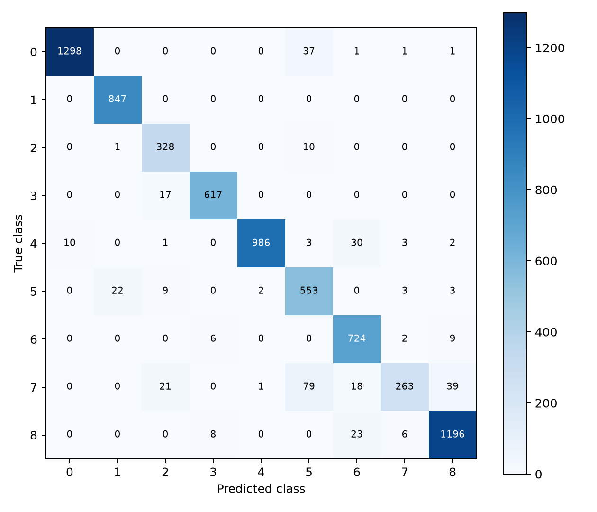

课程第一阶段 · AI工程实践主报告

# AI辅助医学图像分类的工程实践

## 以 PathMNIST 项目为例

Vibe Coding × Harness Engineering：需求拆解、代码执行、结果核验与交付

| 项目 | 说明 |
|---|---|
| 课程 | 研究生工程实践（秋学期） |
| 汇报人 | 王张文皓（12615035） |
| 小组成员 | 赵昱淳（12615027）、李以祺（22615003）、朱逸枫（12615026） |
| 学号与个人分工 | 代码实现：王张文皓；规划：赵昱淳；测试整理：李以祺；云端报告：朱逸枫 |
| 实际提交日期 | 待填写 |
| 科学证据 | 原项目固定提交 d5e4a71…84d1d |
| 本文定位 | 已有项目的AI实践重组；不产生新的模型实验 |

**项目技术任务。** 使用结直肠病理图像块完成九类组织分类，并比较模型方案、输入尺寸和几何增强。模型是现成架构，不是本组提出的新网络。[S03]

**本次报告重点。** 说明人与ChatGPT、Codex、DeepSeek如何分工，怎样从自然语言任务走向可运行代码，怎样检查、修复并保存证据。分类结果是过程的产物，不作为AI比人工开发更有效的因果证明。[S02、S20]

本提交仅为图像块分类的课程实践，不包括患者诊断、整张切片分析或课程第二阶段的树莓派ECG系统。

---

# 摘要与阅读导航

本项目以PathMNIST九类病理图像块分类为载体，实践课程提出的“需求—生成—运行—测试—评估—评审—回滚”流程。用户通过多轮对话说明方向、数据位置、实验范围和停止条件；ChatGPT参与方案讨论、交接与内容解释；Codex读取项目、编写并运行代码、生成阶段记录和核验材料；DeepSeek在第六阶段对量化方案作风险审查，生成指标和绘图草稿。各工具的参与范围由相应记录支持，不把一份概述或建议写成已执行实验。[S01–S02、S08、S13–S14]

执行采用逐级扩大范围的方式：先核对数据与环境，再进行真实小样本训练与重载、最大输入下的批量可行性检查和单个正式基线，随后完成A—E五组、每组三种子的十五条正式训练。项目记录了数据清单、代码与权重标识、逐轮历史和逐图预测，利用脚本复算指标，辅以AI源码审查和人的范围决策。验证近满分引出了高分审计，正式评价之前按验证分数与CPU开销选定D_seed2026并冻结；没有根据测试后E更高的结果回头改变本轮选择。[S04–S12]

工程迭代中，ChatGPT升级建议与当前源码存在不一致，Codex核对后只采纳适用部分；DeepSeek指标草稿因输入契约检查不足未直接使用；初始量化出现严重精度退化，第七阶段有限的混合精度干预将验证Macro-F1恢复至0.995668，但同次CPU前向更慢，默认演示继续采用FP32 ONNX。[S08、S13、S15–S18]

项目最终形成模型与评价记录、数据探索、AI使用日志、离线演示及版本化材料。本文将自动计算、AI辅助审查、人工决策和设备验收分层说明；缺少患者／切片ID、仅一个外部中心、没有无AI开发对照，以及若干课程覆盖差异仍然保留。2026年10月19日已发布独立教师仓库，补齐原演示资产、验收新副本并通过真实CI；按小组决定公开，无需账号邀请。[S20–S21]

关键词：AI辅助编程；Vibe Coding；Harness Engineering；PathMNIST；结果核验；工程交付

## 阅读方式

第1—3章说明任务和执行过程，第4—5章重点说明核验与交互，第6章给出实际结果，第7—8章说明复用和反思。数据细节、交互原文和完整模型评估分别见三份附件。文中[S编号]见文末来源导航；每项历史“通过”均指其原始记录，不冒称本轮重跑。

---

# 1 课程任务与项目目标

## 1.1 从课程要求确定实践重点

课程第一阶段允许从公开医学或生理数据库中选择一个识别任务，借助AI完成基线模型，并提交数据集探索笔记、Vibe × Harness使用日志与评估报告。医学图像条目包括分类、迁移学习、量化后离线推理，以及形状、标签、增强和指标检查。课程并非只要求最终取得一个较高准确率。[S01]

因此，项目有两条同时存在的目标：技术上完成可以评价的组织分类任务；学习上掌握如何给AI提供上下文、拆解任务、执行小测试、解释输出、处理错误并保存可追溯成果。二者不能互相替代：只有工作流而没有真实产物不完整，只有高分而没有AI交互与核查过程也不符合本次汇报重点。

## 1.2 为什么选择医学图像与PathMNIST

早期AI日志记载，用户选择医学图像方向，将具体子集交由助手推荐；随后采用PathMNIST。课程资料本身列有MedMNIST系列，任务标签、文件格式和官方划分适合建立有限规模的分类基线。这里能说明的是选择过程和任务适配性，没有记录多个数据集的训练海选，因此不补写不存在的数据集排名。[S01–S04]

PathMNIST提供结直肠H&E病理图像块及九种组织标签。本项目读取官方128像素版本；同一张图像缩小至64像素用于尺寸对照。训练、验证和测试分别为89,996、10,004和7,180张。前两份来自同一开发来源，测试来自另一中心。原始来源名称与项目划分角色分开：CRC-VAL-HE-7K在本项目中是测试集，并非早停使用的验证集。[S03–S04]

## 1.3 实验范围与未覆盖内容

网络选择限定为ResNet-18和MobileNetV3-Small，不搜索全部架构。A—D构成两种模型与两种尺寸的对照；E只关闭D的整套几何增强。每组三种子用于观察固定划分下的训练波动。十五次正式训练不包含smoke、恢复短轨迹或量化校准。[S03、S05–S06]

本项目不具备患者级诊断、患者级分组交叉验证或临床有效性证据。原NPZ缺少可靠患者／切片标识，不能把图像索引当作患者ID。课程第二阶段的硬件采集和端云系统也不在本件已完成范围内。[S01、S04]

---

# 2 人与AI工具的协作组织

## 2.1 分工不是工具排行榜

| 角色 | 实际承担的工作 | 需要保留的界限 |
|---|---|---|
| 用户／小组 | 提出方向、服务器和目录约束；讨论范围；决定继续或停止；核对最终提交与真实贡献 | 不据此声称手写或逐项人工复算了全部代码和结果 |
| ChatGPT对话 | 方案讨论、质询与解释，形成交接文件；审阅材料和组织报告、PPT | 并非每次讨论都能访问现场代码；建议必须回到实际项目核对 |
| Codex | 读取仓库、编写脚本与测试、服务器执行、阶段记录、复算和部署加固 | 自动核验与AI目视检查不能冒充病理专家复核 |
| DeepSeek网页 | 第六阶段量化风险审查、指标与绘图草稿 | 未参与A—E训练；其回复不是实测数据或第三方认证 |

以上为工作类型归纳，具体发生时间以各阶段AI日志为准。没有使用Claude Code，也没有通过Claude Code路由接入DeepSeek的证据。[S02、S08、S13–S14]

## 2.2 交互通过材料衔接，而不是依赖AI“记得”

项目并非一次提示自动完成。阶段之间用方法协议、运行摘要、HANDOFF、验收清单和已有文件传递上下文。任务文档说明要读什么、允许改什么、禁止动什么、应产生什么文件，以及用什么检查放行。用户要求“每一阶段做好记录，最终用于汇报和报告”，因此留档不是最后补写，而是阶段工作的一部分。[S02、S14]

源码和日志与对话建议冲突时，先核对项目事实。比如升级建议曾把早停列为不足，但当前代码已有早停；Codex通过源码审阅识别了这一差异。交接文档的作用是减少信息丢失，不是替代事实核对。[S08]

## 2.3 人的责任怎样体现

人的责任主要表现为目标和风险取舍：指定只操作本人项目目录、批准阶段推进、决定不盲目增加模型与轮数、接受未解决的数据限制，并确认报告能表达什么。某条日志只写“人工修订”而没有姓名时，本报告不把它归给某位组员。成员分工已由小组补充，见第8.3节；未署名的历史操作仍不逐项归给个人。[S02、S14、S20]

---

# 2.4 Vibe与Harness在项目中的具体含义

课程材料将Vibe Coding解释为自然语言驱动、执行反馈与人机协作；将Harness Engineering解释为可验证、可回滚、可审计的工程约束。本文沿用课程的操作性定义，不扩展为关于所有AI编程方式的普遍结论。[S01]

| 环节 | 本项目怎样做 | 留下什么 |
|---|---|---|
| 描述需求 | 说明医学图像任务、数据位置、范围及禁止事项 | 用户任务与阶段交接 |
| AI拆解 | 拆成数据、实验配置、运行步骤与验收要求 | 协议、矩阵和清单 |
| 生成并执行 | 编写代码后先进行小范围检查，再扩大 | 命令、日志、退出码、产物 |
| 读取反馈 | 对照报错、指标、图表及冻结来源 | 审查结论与问题记录 |
| 修正与再验收 | 只改相关部分；必要时独立目录实现 | 新检查结果、旧件保护记录 |
| 交付 | 报告、演示、源表、下载与版本导航 | 可阅读、可核对的文件集合 |

Vibe与Harness不是前后互斥的两个阶段。生成代码时就需要约束输入和输出；运行时要记录状态；反馈修正后要重新检查相关功能。一个AI生成、另一个AI赞同，并不自动构成确定性验证。[S02、S13–S14]

## 任务描述的实际改善

早期自然语言给出方向和阶段要求，后来的补漏交接更明确地规定：不重训、不重跑官方测试、不改冻结；取回已有证据，开发独立FP32演示，并验收异常输入与断网条件。这种变化体现了交互从“请帮我完成任务”逐步转为“在明确边界内交付可核对产物”。[S14]

这里没有完整的工时或token对照，不能由交互方式的变化推算节省了多少时间。能确认的是任务、检查和产物之间的联系更明确，而不是量化的效率提升。

---

# 3 从选题到实验完成的全过程

## 3.1 数据与环境：先限制操作范围，再生成实现

用户确定医学图像方向后，AI推荐并解释PathMNIST；数据准备阶段，用户又限定只在本人服务器项目目录操作，不在本机下载完整数据，并避免干扰其他项目。Codex据此建立独立环境、下载官方数据、核对MD5，生成类别计数、样例图和数据清单。后续训练和冻结使用同一数据标识。[S02、S04]

这一阶段的产物不是模型分数，而是能够被后续代码可靠读取的数据及其身份记录。跨集合完全像素重复为零，但检查没有提供患者ID，因此没有将“文件正确”扩大为“患者完全隔离”。用户的目录约束控制操作范围，脚本的形状、计数和哈希检查则控制输入质量。

## 3.2 从自然语言到固定协议

项目通过多轮沟通把问题落实为两种模型、两档尺寸和一组增强消融。两种网络使用各自ImageNet V1权重，替换九类输出层并全网络微调。训练采用共同配置，主指标为验证Macro-F1。这里是代表性模型方案的比较，不是先通过小样本选出全局最优模型。[S03]

| 固化对象 | 意义 | 不能替代什么 |
|---|---|---|
| 数据manifest | 指明同一份数据、标签和有效索引 | 不替代来源与患者独立性解释 |
| 实验matrix | 明确A—E、种子、尺寸和共同训练设置 | 不等于每个网络已最优调参 |
| source_id | 识别正式源码版本 | 不单独证明实现没有错误 |
| 方法协议 | 明确验证、选模、测试和报告口径 | 后续仍需检查实际执行是否相符 |

这些文件是把讨论转成可执行约束的产物；没有记录的候选或步骤，不补写成完整的预注册模型搜索。

---

# 3.3 逐级执行：从smoke到十五条正式轨迹

| 顺序 | 实际工作 | 通过后为什么能进入下一步 |
|---|---|---|
| 真实小样本smoke | 144张训练、72张验证，一轮；检查训练、保存与重载 | 说明关键数据流可以贯通，不用于报告分类效果 |
| 最大输入probe | 两种网络在128输入下测试batch；128可完成前向、反向和优化器步进 | 提供共同可用批量，不证明最优分类精度或吞吐 |
| 单次正式基线 | A_seed42使用完整train/val；40轮中第35轮最佳 | 留下首条完整正式轨迹及独立指标复核 |
| 主对照扩展 | 阶段脚本完成其余11条A—D轨迹 | 同一协议下形成四组、三种子的比较 |
| E组消融 | 原配置关闭几何增强，运行三个种子 | 补齐原定增强比较，正式总数达到15 |

阶段记录给出了实际入口与脚本；“批量执行”是概括，不写成一条run-matrix命令一次性完成全部历史工作。[S05–S06、S02]

## 为什么每次运行都留文件

训练过程中记录配置、数据和源码身份、逐轮历史、最佳权重、验证预测、指标与运行状态。它们支持不同问题的核查：history解释实际轮次，run配置解释参数，预测CSV支持复算，checkpoint与冻结记录绑定模型来源。日志和退出码帮助区分启动、运行结束与验收通过。[S05–S06]

原训练程序已有验证早停，最多40轮、连续8轮不改善则停止。它主要保存最佳权重，不具备完整状态恢复；完整续训后来在独立resume_v2原型中实现和验收，没有替换已完成的正式训练。这避免把新工程功能倒写成原15条轨迹已经使用。[S08–S09]

---

# 3.4 从高分质询到冻结评价

A—D验证分数接近满分后，项目没有立即宣称模型完美，而是增加只读管线审计、近重复候选筛查和敏感性复算。没有发现训练验证数组混用、验证随机增强、标签错位或指标误算；候选图像不能被定性为患者泄漏。相关审计发生在正式测试之前。[S07]

项目随后确定停止继续扩大模型和长训练范围。冻结选择只看A—D的验证组均值：距最高组不超过0.005的配置进入候选，比较统一CPU开销，再在选中组内按验证F1选一份权重。最终演示模型为D_seed2026。E作为预定消融，不参与本轮演示配置选择。[S10–S11]

冻结后统一评价全部15条预定轨迹，保留所有测试结果。测试中E组均值高于D，没有因此改写选择规则。修复核验脚本时也只重新运行核验，不重新生成正式测试预测。这里体现的约束不只是“禁止更新测试权重”，还包括不根据已见测试成绩重新定义本轮胜者。[S10]

## 3.5 测试后的分析、部署与文稿

正式测试之后，项目使用已存预测进行D/E逐类差异与置信度统计；这些是描述性分析，不倒写成事前假设，也不据此选择新的拒识阈值。工程上继续导出FP32 ONNX、试验量化、完善独立演示和材料。第七阶段补齐轻量证据与运行验收记录，不重训A—E。[S14–S18]

报告和PPT经过多轮调整，从以分类结果为主转为AI实践主线。这属于提交材料的新版本，不更改实验日期或结果。原科学仓库作为来源保留；另建教师提交目录，是对用户最后确认的交付范围的执行。[S20]

---

# 4 自动核验、AI审查与人工评审

## 4.1 按检查方法分层，而不只按工具名称分层

| 层次 | 典型对象与方法 | 执行与来源 | 结论范围 |
|---|---|---|---|
| 自动／确定性检查 | 形状、标签、概率、哈希、指标复算、冻结文件 | 程序执行；可由Codex生成或调用 | 在定义条件下数据与计算一致 |
| AI辅助审查 | 阅读源码、日志、图表，发现不一致与提出风险 | Codex、独立审查代理、阶段性DeepSeek | 形成待核对意见，不是新的实测结果 |
| 人的评审与决策 | 范围、路径、预算、是否采纳和报告表述 | 用户确认和小组真实记录 | 决定下一步与承担提交责任 |

一个由AI编写的脚本，真正执行后产生的复算结果，属于自动检查；不能因为脚本作者是AI，就与AI语言上的“认为正确”混为一类。反过来，即使独立代理复算一致，也可能与原脚本共享错误假设，因此仍需要清楚的指标定义和输入契约。[S02、S13–S14]

## 4.2 核验的最小记录单位

一项“通过”至少对应检查对象、方法、实际输入、代码或环境版本、执行结果、来源文件和限制。比如“验证指标复算通过”需要说明读取哪份预测CSV、检查多少行、怎样固定九类标签，而不能只截取绿色passed一词。不同阶段的测试数可能有重叠，不简单相加为一次独立测试总数。

第七阶段留有30份正式预测的复核汇总，但本轮写作没有重新从30份完整概率CSV计算全部AUC。文稿所用的组均值和混淆矩阵算术检查，与历史完整概率级复核分开记录。[S17、S21]

---

# 4.3 “检查通过”不等于什么

| 记录 | 可以说 | 不可以据此说 |
|---|---|---|
| 文件SHA一致 | 本地副本与指定来源字节一致 | 模型临床有效、科学解释正确 |
| 精确重复为零 | 未发现逐像素完全相同的跨集合图像 | 已排除同患者、邻近块或变换图关联 |
| 静态结构检查 | 文件／代码满足检查器覆盖的条件 | 模型已经在真实设备运行 |
| 合成输入通过 | 已构造输入上的程序行为符合预期 | 合成数据分数是正式医学实验成绩 |
| 固定真实样例推理 | 特定模型与样例可运行，输出与参考匹配 | 已评价全部真实使用场景 |
| Mac断网记录 | 所记环境已完成依赖后的断网演示 | 断网安装、Windows/Linux或投影均已通过 |
| 三种子均值和SD | 固定划分下的训练结果与波动 | 患者置信区间或临床显著性 |

主报告保留这一表格，是为了让教师能够区分项目真正具备的证据层次，而不是把所有“验证”合并成一句结论。[S04、S07、S09、S14、S17–S18]

## 人工复核的真实状态

历史记录中的一些图表由Codex目视检查，不能称为病理专家人工复核。成员、学号与责任范围已由小组补充；未留记录的操作仍不虚构署名。用户决定以可打开的PPT提交，不要求现场投影验收。医学解释没有专家证据时只描述数据标签与模型混淆，不依据病理图像外观改写真实标签。[S02、S14、S20]

---

## 4.4 发布接手的分层验收

发布接手的验收对象是教师提交副本，不是重新评价正式模型。下表分别列出资产、运行、界面、检查器、云端与获取证据；各层检查不能相加为“医学验证总数”。

| 层次 | 2026年10月19日记录 | 可以说明 | 结论边界 |
|---|---|---|---|
| 运行资产 | 1个FP32 ONNX与10张固定验证PNG，共11份；复制后逐个核对哈希 | 基本演示原件已进入新库 | 没有重训、重导出或迁移完整数据集 |
| 新副本运行 | 独立Mac arm64新目录；20项运行及格式、异常、文件保护检查 | 所列环境与输入下行为符合预期 | 不是20个病例或新的外部测试成绩 |
| 浏览器用例 | 4项：正确、不一致、有效上传、损坏上传；3次真实验证样例前向 | 所列页面流程可执行 | 不是4个新测试集，也不是浏览器全局断网 |
| 检查器测试 | 21项合成及边界单元测试 | 提交检查器的所列行为通过 | 不是分类网络的新实验成绩 |
| GitHub Actions | 运行检查器测试及严格文件、保存结果算术检查 | 指定提交的云端质量门通过 | 没有在云端训练、加载模型或建立推理服务 |
| 对外获取 | 公开库及Release；匿名下载后核对附件哈希 | 外部读者无需原私有库权限获取材料 | 不证明临床使用或独立复现实验 |

命令行运行验收由操作系统限制外网。浏览器用例中，应用仅允许本机回环访问，浏览器本身未全局断网。依赖安装与断网运行也属于不同环节。[S21–S22]

依据为运行资产复制表、新副本运行JSON、浏览器回执与云端记录。2026年10月19日的真实CI以指定提交和运行链接为准；本次文稿同步不重新执行模型验收。[S21–S22]

---

# 5 典型交互与问题修复

## 5.1 ChatGPT升级建议为何没有全部执行

**交互背景。** 用户将另一段ChatGPT方案及两份建议文档交给Codex，要求先核对项目已完成内容，再评估是否采用。建议涉及早停、断点恢复、200—300轮和更多训练轨迹。[S08]

| 建议或判断 | Codex对当前源码的核对 | 实际取舍 |
|---|---|---|
| 缺少自动早停 | 不成立；已有验证F1和patience=8 | 保留原实现，不重复“补早停” |
| 缺少完整续训 | 成立；best.pt缺优化器、调度器、随机状态 | 独立实现恢复原型并小范围验收 |
| 原40轮直接续到200轮 | 学习率轨迹改变，不能称原轨迹精确延续 | 新预算若执行需独立协议；没有默认开跑 |
| 追加最多28条轨迹 | 属于建议预算；增强参照与原E组不一致 | 先完成原E，再决定范围；没有照单全收 |

**实际产物。** 一份源码审阅记录、一套独立resume_v2原型和历史恢复核验记录，而不是28条新正式实验。恢复检查比较了连续4轮与2轮后恢复的短轨迹，24项状态检查一致；这只证明所检查的工程恢复行为，不提供新的正式医学分类成绩。[S08–S09]

**实践收获。** 跨会话建议会遗漏代码现状。任务交接必须包含当前实现和完成状态；让执行代理先读取，再判断，优于仅依据建议稿扩大任务。原始建议并非因出自ChatGPT就必须采用。

---

# 5.2 DeepSeek提供另一份意见，但草稿仍需审查

第六阶段实际使用已登录DeepSeek网页，发送公开方法概述，要求审查冻结后PTQ方案，并给出概率对比函数和绘图草稿。没有向该对话提交完整源码、原始图像、逐图预测或服务器凭据。原提示与回复摘要保存在阶段记录中。[S13]

**原提示节选：**

> 请只依据上述公开方法信息回答，不假设你已运行该项目。

这条约束避免把语言审查误当远程实验。DeepSeek指出校准与验收分工、数值退化、延迟可比性、概率接口和逐类退化等风险。它的指标函数却没有完整检查非空样本、0—8标签、概率非负和固定九类labels。因此该函数没有直接进入正式管线；项目继续使用既有指标实现。[S13]

绘图草稿属于另一项产物。它经过协议校验、数值标签位置、字体和非法输入处理等修改，先使用合成JSON检查脚本，再用实际量化汇总生成结果图。合成图的数值不进入科研结果。不能把“建议被采用了一部分”改写成“DeepSeek开发并验证了整个项目”。[S13]

| 交互点 | 用来约束AI的做法 |
|---|---|
| 提供上下文 | 给出任务、输入、已使用测试集、允许的train/val角色 |
| 明确输出 | 限定风险数量、函数接口、图表字段和文件格式 |
| 指定禁止项 | 不假设已运行、不建议用测试调参、不编造结果 |
| 审查后采纳 | 风险建议参考；指标草稿不采用；绘图修订后使用 |

原日志未把“人工审查”署名到个人，本报告也不替任何成员认领。成员责任范围已由小组补充。

---

# 5.3 量化失败后的有限干预与不替换决定

初始S8S8、U8U8验证Macro-F1分别约0.3755、0.3935，程序虽生成模型，效果却严重退化。第七阶段在不重训、不使用官方测试的限制下，用训练样例调查中间误差，并预先登记一个有针对性的候选：保留早期五个指定Conv为浮点。[S15]

诊断过程中也发现调试助手自身对uint8计算可能回绕的问题，之后通过类型提升与反量化对照复核。它是诊断辅助计算的问题，不能被写成已经找到了ONNX真实推理失败的唯一根因。最初reader接口、基线路径与记录字段错误的失败日志也被保留。[S15]

| 同次第七阶段对照 | FP32 | 混合精度PTQ |
|---|---|---|
| 验证Macro-F1 | 0.998073 | 0.995668 |
| 模型大小 | 5.8450 MiB | 1.7596 MiB |
| CPU前向中位延迟 | 0.422792 ms | 0.533642 ms |

候选通过项目预设验证精度门槛，文件缩小约69.9%，但前向耗时增加约26.2%，且没有新的外部测试。实际处理是保留候选，默认演示继续使用FP32。没有为了把量化写成成功加速而删除失败记录或改换计时基线。[S16]

**这个案例展示三种不同判断。** 程序能生成模型，是运行层面；验证精度达到门槛，是工程验收层面；是否替换默认版本，要结合速度、大小、证据和使用目标。AI能够辅助每一步，但不能用一条高分替代整个取舍。

---

# 6 实际产物与实验结果

## 6.1 实验是AI工作流的产物，不是AI效益的对照试验

十五条正式轨迹均有保存结果。以下为三种子组均值，测试Macro-F1的±为样本标准差；未进行患者置信区间估计。[S12]

| 配置 | 验证F1均值 | 测试F1均值±SD | 测试Accuracy | CPU前向组均值 |
|---|---|---|---|---|
| A ResNet-18／64 | 0.995818 | 0.905852±0.000286 | 92.70% | 10.586 ms |
| B ResNet-18／128 | 0.998599 | 0.909398±0.004295 | 93.19% | 12.540 ms |
| C MobileNet／64 | 0.992592 | 0.867163±0.009064 | 89.19% | 1.679 ms |
| D MobileNet／128 | 0.997821 | 0.924315±0.004119 | 94.33% | 1.845 ms |
| E D关闭增强 | 0.996269 | 0.934814±0.007555 | 95.16% | 1.851 ms |

输入尺寸比较中，B−A约+0.0035，D−C约+0.0572；提高尺寸的组均收益依赖模型。固定128输入，D对B同时获得较高测试F1和较低服务器CPU前向开销。D−E在验证为+0.001552，在测试为−0.010498，说明同中心验证收益没有延续到当前外部中心。[S12]

上述数字说明项目确实形成了可评价的模型结果，不证明AI辅助比人工开发更快、成本更低或精度更高。项目没有无AI对照和完整工时账本，不能据此报告百分比效率收益。

## 6.2 AI如何帮助整理讨论

AI帮助从保存的源表定位差值、检查统计口径、生成图表和解释术语。讨论保留“已观察到什么”与“为什么发生”之间的差别。跨中心下降可观察，但没有证据分离染色、采样、类别构成与过拟合各自的贡献；增强反转可观察，但没有单项增强机制试验。

---

# 6.3 从总体分数到弱类别

D_seed2026是测试前选定的一份权重，不等于D组三种子均值。该模型测试Accuracy为94.87%、Macro-F1为0.9290；癌相关间质Recall为62.47%，421张真实间质图像中识别263张，其中79张被预测成平滑肌。[S10–S12]

AI可以帮助指出哪些类别值得进一步查看，但不能依据几张图像自动完成病理专家复核。第七阶段还发现高置信预测依然包含错误；这些置信度统计没有被用于训练校准器或确定新的拒识阈值。[S14、S19]

## 讨论与后续决定

本轮结果的作用是形成可解释、可核查的课程案例。后续没有继续使用已见测试结果进行选择，也不因报告主线转为AI而改变科学结论。更广架构、分组交叉验证或量化训练属于另行设计的可能研究，不计入已完成工作。

---

# 7 工具封装、GitHub与复用

## 7.1 离线演示是独立可使用产物

冻结的D_seed2026导出为FP32 ONNX；独立程序在本地CPU读取图像、按固定预处理预测并展示结果。第七阶段记录了Mac精简环境、搬迁目录、固定真实样例、异常输入和依赖安装后的断网检查。它不依赖完整训练数据或PyTorch，但并非无需安装依赖，也没有覆盖所有系统和临床场景。[S17–S18]

## 7.2 科学来源与教师提交版本分开

原仓库保留阶段一至七的历史事实和固定科学证据。新的教师提交目录只整理当前PPT、主报告、三份附件、必要源码和证据快照，不是新的模型实验，不修改原仓库。来源表记录复制文件的项目路径、版本和SHA，避免把后来文稿当成事前协议。[S20–S21]

| 教师需求 | 本目录提供的路径 |
|---|---|
| 只阅读成果 | README → PPT → 主报告 → 附件 |
| 核对一个数字或案例 | 来源索引 → 保存JSON/CSV/日志 → 对应代码 |
| 运行演示 | demo说明 → 校验原FP32和样例 → 安装依赖 → 本地预测 |
| 完整重训 | 仅参考原训练入口，须在新环境、新目录另行设计；不是默认验收 |

独立教师仓库Wenhow1/pathmnist-ai-practice-submission已上传，并按小组决定公开。FP32模型及10张固定PNG已按原哈希补齐，新副本在Mac独立环境完成20项检查与4项浏览器验收。真实CI只查文件和保存结果算术，不执行模型。必要运行资产可从新库获得，无需邀请。PPT保留可打开的文件与PDF；现场投影不列为本次要求。[S21]

## 7.3 实际可复用能力与Skill边界

已有CLI、审计脚本、恢复原型、演示程序和打包逻辑具有复用价值，但并不自动等于正式Agent Skill。当前没有可追溯的项目专用local/global Skill调用记录，因此不列为已使用成果；这也不等于断言所有平台都从未使用任何内部通用能力。提交阶段新增CI已有真实通过记录，仅检查文件与保存结果算术，不属于原训练期成果。

---

## 7.4 从ChatGPT交接包到公开GitHub交付

2026年10月19日，项目从文稿整理转入发布接手。ChatGPT会话已形成主报告、附件、PPT、检查器和交接任务包；用户将材料交给已有Codex会话，在获授权工作区继续执行。本次没有由ChatGPT自动创建新的Codex对话或自动派发任务。[S20–S22]

| 环节 | 实际衔接 |
|---|---|
| 交接 | ChatGPT整理报告、PPT、检查器和执行清单，用户交给已有Codex会话 |
| 核对与复制 | 保护原仓库，核对当前文件，仅复制原模型与固定验证样例 |
| 新副本验收 | 独立环境及新目录检查参考输出、异常输入与文件保护 |
| 云端与获取 | 指定提交运行CI，公开发布附件，再匿名下载核对哈希 |

Codex先核对当前目录、原仓库版本及文件哈希，再从既有归档复制FP32 ONNX与10张固定验证样例。原科学仓库保持保护，新教师仓库承接阅读和交付；不能用旧ZIP覆盖已有的新修改，也不把资产复制写成模型重训。

随后在独立Mac环境和新目录验收固定样例与异常行为，并推送教师仓库运行云端文件和保存结果算术检查。仓库初建为私有，后按小组决定公开；v1.1.0-teacher保留了完整材料包、独立演示包与校验值，发布回执记录材料提交、CI及匿名下载核对。[S21–S22]

新副本检查回答“搬迁后程序能否保持参考行为”，CI回答“提交文件及保存结果是否符合检查条件”，匿名下载回答“外部读者能否取得同版材料”。本轮v1.2.0-teacher只同步文稿与发布过程，不重训或重开官方测试。各层证据共同支持交付，不构成新增临床验证。

---

# 8 反思、局限与贡献说明

## 8.1 本次实践形成的工作方法

第一，任务需要写清目标、上下文、允许的修改范围、输出文件和验收标准。第二，执行应从小到大，代码生成后要运行，运行后要查看独立证据。第三，AI建议应允许被修正或否决，不能将“更多训练”“更复杂工具”当成默认进步。第四，失败和未覆盖项要留档，最终交付不能靠删除负面结果显得完整。[S02、S08、S13–S17]

这些是本项目过程归纳，不是已量化的教学效果或AI效率实验。没有无AI对照、精确工时、成本和token账本，不能编写节省百分比。

## 8.2 课程覆盖差异仍需如实保留

| 事项 | 本项目实际状态 |
|---|---|
| 交叉验证 | 未做K折；缺可靠患者／切片分组ID；用户决定不追加；无教师豁免记录 |
| 指定工具 | 实际ChatGPT对话、Codex执行与阶段性DeepSeek网页；未用Claude Code |
| 类别不平衡 | 报告宏平均和逐类指标；普通交叉熵，未做加权或重采样 |
| 量化 | 混合精度通过验证门槛；不是全INT8，当前CPU未加速，无新外测 |
| 云端自动检查 | 原训练期无Actions证据；提交期真实CI通过，仅查文件与算术 |
| 临床与设备 | 无患者级临床验证；Mac历史验收不推广为全平台验收 |

这些差异不会因报告改为AI实践主线而自动变成“已满足”。课程原文与实际完成情况应同时呈现。[S01、S14、S21]

## 8.3 个人与工具贡献

王张文皓（12615035）负责代码与技术实现；赵昱淳（12615027）负责项目规划；李以祺（22615003）负责后端测试与代码整理；朱逸枫（12615026）负责云端维护与报告整理。分工依据小组提供的信息；AI参与实现与自动执行按日志如实保留，不将未署名的历史操作归给个人，也不编造工时或贡献比例。

责任范围对应资料：王张文皓见[代码快照](../technical/source_snapshot/)、[演示说明](../demo/README.md)；赵昱淳见[方法与实验协议](../evidence/source/docs/方法与实验协议.md)、[阶段决定](../evidence/source/stage4/最终测试前实验清单决定.md)；李以祺见[源码测试](../technical/source_snapshot/tests/)、[提交检查说明](../reproducibility/运行命令.md)；朱逸枫见[发布接手记录](../reproducibility/发布接手记录.md)、[云端回执](../reproducibility/cloud_verification.json)。入口仅供定位，不作个人逐条操作署名。

## 结论

本项目完成了以真实医学图像分类为载体的AI辅助工程案例。其价值在于把自然语言任务落实为运行、核查、修复和交付，并能指出每项证据支持到哪里。它既不是新医学算法的声明，也不是“AI永不出错”的展示，而是一套保留错误、允许否决、重视来源的课程实践过程。

---

# 来源导航与提交说明

文内编号供主报告、AI日志附件与PPT交叉引用。完整路径、来源文件SHA和范围见本目录reference/来源编号与阅读索引.md及evidence/source_provenance.json。

| 编号 | 主要依据 |
|---|---|
| S01 | 用户提供的课程原始要求 |
| S02–S06 | 历阶段AI日志、方法、数据与训练记录 |
| S07–S09 | 高分审计、ChatGPT升级建议核对、独立恢复原型 |
| S10–S12 | 冻结与正式测试记录、frozen.json、十五条结果表 |
| S13 | DeepSeek原提示、草稿审查与绘图修订 |
| S14–S18 | 第七阶段AI日志、量化诊断、候选结果及演示验收 |
| S19 | 数据计数及既有D/E、置信度描述 |
| S20 | 当前对话中用户确认的改稿与新仓库范围 |
| S21 | 本提交的文件核查、新副本运行与真实云端发布记录 |
| S22 | 公开交付过程与本次定向同步依据；详见来源索引 |

历史来源文件中的“当前”“只在服务器”等措辞描述当时状态；不以它们替代新提交状态。正式数据和权重依然来自原固定实验，本轮未训练、未推理官方测试、未改变结果。发布接手已更新S21中的仓库、运行记录和真实CI链接；Release与提交SHA以云端回执为准，公开访问以未登录读取回执为准。
